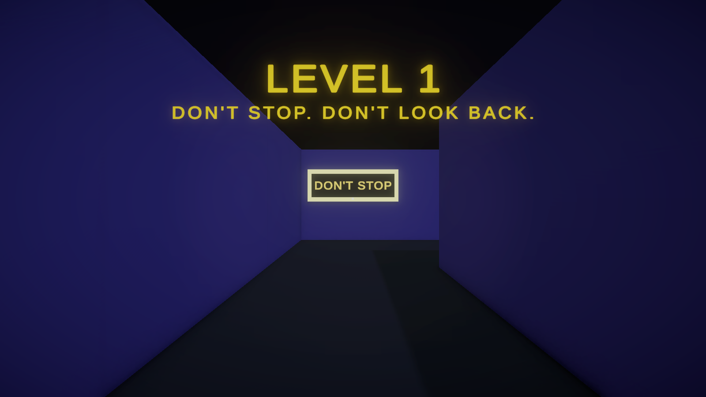

# Sprint or Shift

A first-person maze runner where you cannot stop, and the maze changes behind your back.

**Course:** Game Design, Dr. Arafa Taher
**Team:** Adel Nabih, Maryam Sherif, Ali Eissa
**Engine:** Unity 6 (6000.4.0f1), Universal Render Pipeline

## Controls

| Input | Action |
|---|---|
| W A S D or arrow keys | Move |
| Mouse | Look around |
| Left click | Capture the mouse (if it was released) |
| Esc | Release the mouse |
| R | Play again (on the victory screen) |

## Rules

1. **Don't stop.** Stand still for 2 seconds and you are teleported back to START. A red "DON'T STOP!" overlay with a countdown warns you first. The timer starts with your first step, so waiting at START is safe.
2. **Don't look back.** Purple walls move only after you have seen them and they are behind you. One-way gates close after you walk through them. Toggle walls (Level 2) flip open or closed each time they end up behind you.
3. **Dead ends are traps.** If you get boxed in, stand still for 2 seconds. You go back to START and every purple wall resets.

**Goal:** reach the glowing cyan Finish Portal. Level 1 (tutorial) leads to Level 2 (high chaos), then the victory screen.

## How to run

**Playable build (macOS)**
1. Unzip `Submission/Prototype/SprintOrShift-macOS.zip`.
2. Right-click `SprintOrShift.app` and choose **Open**. The app is not signed, so macOS asks for confirmation the first time.

**Unity project**
1. Clone this repository, then in Unity Hub choose **Add > Add project from disk** and select the repository folder.
2. Open it with Unity 6000.4.0f1 (any Unity 6 version with URP should also work).
3. Open `Assets/Scenes/Level1.unity` and press **Play**.

The scene setup, Inspector fields and script walkthrough are in [SETUP_GUIDE.md](SETUP_GUIDE.md).

## Submission contents

| Item | Location |
|---|---|
| Game Design Document | `Submission/GDD/Sprint_or_Shift_GDD.pdf` |
| Playable prototype | `Submission/Prototype/SprintOrShift-macOS.zip` and this repository (Unity project) |
| Screenshots | `Submission/Screenshots/` |
| Diagrams (level maps, core loop, wall logic, MDA) | `Submission/Diagrams/` |
| MDA analysis | `Submission/MDA_Analysis.docx` (also in the GDD) |
| Playtesting notes and planned improvements | `Submission/Playtesting_Notes.docx` |
| Team contribution summary | `Submission/Team_Contributions.docx` |
| Credits and sources | `Submission/Credits.docx` |
| README with controls and instructions | this file |

## Scope

**Implemented:** first-person movement and mouse look, the 2-second stillness teleport with a warning overlay, line-of-sight wall shifting (one-way gates and toggle walls), wall reset on teleport, two levels, finish portal, level transitions, victory screen, glowing signs, bloom and fog.

**Planned (not implemented yet):** sound and music, main and pause menus, an in-game sensitivity setting, a run timer with best times, a third level, gamepad support and a Windows build.

## Credits

Built with Unity 6, URP, TextMeshPro and the Input System. No third-party art or audio. Code was written with AI assistance from Claude Code (Anthropic). Full list in `Submission/Credits.docx`.
